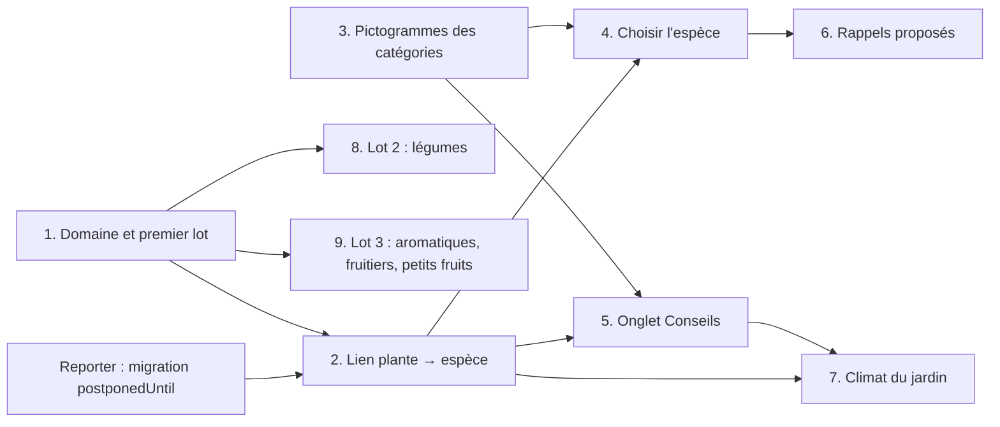

# Étude : le catalogue d'espèces

Étude du 30/10/2026, sans code. Elle prépare le catalogue d'espèces, quatrième des
[étapes suivantes de la vision](vision-produit.md#étapes-suivantes). Elle dit ce qu'une espèce
apporte, lesquelles embarquer, comment tenir compte du climat, d'où viennent les données, où on
les range et comment on les montre. Les points à trancher sont en fin de document,
[« À décider par Maxime »](#à-décider-par-maxime).

## En bref

- **Le catalogue propose, il n'impose rien.** Une espèce préremplit des champs restés vides,
  montre un calendrier et des conseils, et propose des rappels que l'utilisateur ajoute d'un
  toucher. Rien n'est créé sans son accord, et le catalogue ne réécrit jamais une de ses lignes.
- **63 espèces au premier lot** : 38 légumes, 10 aromatiques, 8 fruitiers et 7 petits fruits.
  La variété (« Cœur de bœuf ») reste un champ libre.
- **Le climat se règle sur le jardin**, en cinq choix (de « Méditerranéen » à « Montagne ») qui
  décalent les fenêtres par quinzaines : plus tard au printemps quand il fait froid, plus tôt à
  l'automne. La ville de la future météo pourra proposer ce choix, pas l'imposer.
- **On écrit nos propres fiches.** Aucun jeu ouvert n'a de calendrier en français pour nos
  climats. Les plus riches imposent le partage à l'identique (CC BY-SA, ODbL) ou interdisent
  l'usage commercial. Wikidata (CC0) sert pour les noms et OpenFarm (CC0) pour recouper
  espacements et exposition.
- **Le catalogue est une constante TypeScript**, comme `GardenLayouts`. La plante garde son texte
  d'espèce et gagne un `species_id` facultatif. Une mise à jour de l'app change les fiches, jamais
  les données de l'utilisateur.
- **Neuf PR courtes.** Les deux migrations du catalogue passent après celle de « Reporter »
  (`postponedUntil`), en cours dans une autre session.

## La question

Aujourd'hui, l'espèce et la variété d'une plante sont deux textes libres (`garden_items.species`,
`variety`). Le MVP l'a voulu ainsi : « un catalogue viendra ensuite » ([vision](vision-produit.md#ce-quon-suit-par-type-despace)).
Pour le [benchmark](benchmark-concurrents.md#enseignements), le savoir fait la valeur à long
terme : c'est lui qui fera passer Jardo de carnet à assistant. Jardingue affiche 261 variétés et
un calendrier adapté à la région. Planter calcule le sien à partir de la date des dernières gelées.

La vision pose aussi une limite : Jardo n'est **pas une encyclopédie botanique**, et son
catalogue sert la saisie et les rappels. Chaque donnée doit donc servir à un écran ou à un
rappel, sinon elle n'entre pas.

## 1. Ce qu'une espèce apporte

Une « espèce » de Jardo est une **culture au sens du jardinier**, pas un taxon : chou-fleur,
brocoli et chou de Bruxelles sont trois entrées, bien qu'ils soient tous *Brassica oleracea*.
C'est ce que l'utilisateur cherche et ce qui change les dates.

| Donnée | Ce qu'elle apporte | Où | Quand |
|---|---|---|---|
| Nom, synonymes, nom scientifique | Retrouver l'espèce en tapant « salade » ou « potiron » | Choix de l'espèce | **Tout de suite** |
| Catégorie : légume, aromatique, fruitier, petit fruit | Suggestions selon le type d'espace, pictogramme | Choix, fiche | **Tout de suite** |
| Fenêtres par quinzaine : semis sous abri, semis en place, plantation, récolte, taille | Calendrier de l'année, « en ce moment », dates des rappels | Fiche, choix, rappels | **Tout de suite** |
| Arrosage : un rythme en jours, une fois la plante installée et par temps sec | Propose la tâche d'arrosage | Rappels | **Tout de suite** |
| Espacement entre plants et entre rangs | Repère à la plantation | Fiche | **Tout de suite** ; la grille de plantation, plus tard |
| Exposition : soleil, mi-ombre, ombre | Repère pour choisir la place | Fiche | **Tout de suite** |
| Conseils : trois au plus, une phrase chacun | Ce qu'on oublie (tuteurer, butter, pincer) | Fiche | **Tout de suite** |
| Unité de quantité par défaut : pieds, rangs, m² | Préremplit le formulaire (tomate en pieds, carotte en rangs) | Formulaire de plante | **Tout de suite** |
| Unité de récolte par défaut : kilos, grammes, pièces | Préremplit la récolte (courgette en pièces) | « Fait » précisé, intervention | **Tout de suite** |
| Rappels proposés | Voir le tableau suivant | Formulaire, fiche | **Tout de suite** |
| Arrosage selon le stade : levée, reprise, plante installée | Arroser plus souvent les premières semaines, puis espacer | Proposition de changer le rythme d'une tâche | Plus tard, avec les stades de croissance |
| Famille botanique | Rotation des cultures par carré | Contenu d'un espace | Plus tard, avec la rotation |
| Durée de culture (jours jusqu'à la récolte) | Récolte prévue à partir de la date de semis | Rappels | Plus tard |
| Sensibilité au gel | Alerte avant une gelée | Météo | Plus tard, avec la météo |
| Associations favorables ou à éviter | Voisins conseillés | Fiche | Plus tard : les sources ouvertes sont de qualité faible (voir [section 4](#4-source-des-données-et-licence)) |
| Variétés et leurs caractères (précoce, remontant) | Fenêtres affinées, taille selon le type | Formulaire, fiche | Plus tard |
| Maladies et traitements | | | Non : c'est l'encyclopédie, et le conseil phytosanitaire engage |

Les premières semaines d'une plante, il faut l'arroser plus souvent. Tant que les stades
n'existent pas, ce conseil va dans la fiche, et la tâche proposée porte le rythme de la plante
installée. Plus tard, connaissant les dates de semis et de plantation, Jardo pourra proposer
d'espacer l'arrosage, toujours sous forme de proposition. La météo, elle, décalera l'arrosage
après la pluie ([vision, étape 6](vision-produit.md#étapes-suivantes)).

### La règle : le catalogue propose

- **Il ne préremplit qu'un champ vide** ou resté à sa valeur par défaut, jamais une saisie de
  l'utilisateur.
- **Ce que l'utilisateur a déjà fait l'emporte** : la dernière unité de récolte notée sur la plante
  passe avant celle de l'espèce.
- **Un rappel proposé se lit tel qu'il sera créé** (« Arroser tous les 3 jours, à partir
  d'aujourd'hui ») et n'est créé que sur un geste de l'utilisateur. Ensuite, c'est une tâche comme
  les autres : il la change ou la supprime, et une mise à jour du catalogue n'y touche pas.
- **Pas de proposition redondante.** Jardo ne propose pas d'arroser une plante que l'arrosage de sa
  zone ou de son espace couvre déjà. La règle existe : les tâches d'un élément comprennent celles
  de sa zone et de son espace ([modèle](modele-domaine.md#gardentask-tâche)). Il ne propose pas
  non plus une taille déjà prévue sur la plante.
- **Pas de traitement proposé**, ni produit ni dose. Depuis 2019, les particuliers français n'ont
  plus accès aux pesticides de synthèse, et un conseil de traitement erroné engage l'app. Les
  traitements restent des tâches que l'utilisateur crée lui-même.

### Les rappels proposés au départ

Ils reprennent les trois récurrences du modèle, sans rien y ajouter.

| Rappel | Proposé quand | Tâche créée |
|---|---|---|
| Arroser | L'espèce a un rythme et rien n'arrose déjà la plante, sa zone ou son espace | Arrosage tous les N jours, à partir d'aujourd'hui |
| Semer ou planter | La plante n'a pas encore de date de semis (ou de plantation) et une fenêtre arrive | Semis (ou plantation) une seule fois, au début de la prochaine fenêtre |
| Récolter | Culture de l'année, quand sa prochaine fenêtre de récolte est connue | Récolte une seule fois, au début de la fenêtre : la première récolte notée la clôt |
| Récolter chaque année | Vivace, fruitier, petit fruit | Récolte chaque année, au début de la fenêtre |
| Tailler | Fruitier ou petit fruit qui a une fenêtre de taille | Taille chaque année, au début de la fenêtre |

Un fruitier installé n'a pas de rappel d'arrosage : sa fiche conseille d'arroser la première
année, par temps sec.

## 2. Périmètre du premier lot

Ce qu'on trouve dans un jardin familial de France, de Belgique et de Suisse romande, une entrée
par culture. Jardingue compte 261 entrées, mais il y range des variétés. Les 63 cultures de
départ couvrent l'essentiel d'un potager, d'un verger et d'un rang de petits fruits.

| Catégorie | Espèces | Nombre |
|---|---|---|
| Légumes-fruits | Tomate, courgette, concombre, cornichon, courge (potiron, potimarron, butternut), melon, aubergine, poivron et piment, maïs doux | 9 |
| Légumineuses | Haricot, petit pois, fève | 3 |
| Légumes-feuilles et tiges | Laitue, chicorée (frisée, scarole), mâche, roquette, épinard, blette, chou pommé, chou-fleur, brocoli, chou de Bruxelles, chou kale, poireau, céleri, fenouil | 14 |
| Racines, bulbes, tubercules | Carotte, radis, betterave, navet, panais, oignon, échalote, ail, pomme de terre | 9 |
| Légumes vivaces | Rhubarbe, asperge, artichaut | 3 |
| Aromatiques | Basilic, persil, ciboulette, coriandre, aneth, cerfeuil, thym, romarin, sauge, menthe | 10 |
| Fruitiers | Pommier, poirier, cerisier, prunier, pêcher, abricotier, figuier, vigne | 8 |
| Petits fruits | Fraisier, framboisier, groseillier, cassissier, groseillier à maquereau, myrtillier, mûrier sans épines | 7 |

Les cinq premières lignes forment la catégorie « légume » (38). Le type d'espace ordonne
les suggestions. La recherche, elle, couvre tout le catalogue, puisque le modèle accepte une
plante dans tout espace qui n'est pas du bois de chauffage.

| Type d'espace | Suggérées d'abord |
|---|---|
| Potager, serre | Légumes, aromatiques |
| Verger | Fruitiers |
| Petits fruits | Petits fruits |

### La variété

**Champ libre**, comme aujourd'hui. « Cœur de bœuf » n'est pas une espèce : en faire une entrée
multiplierait le catalogue par dix pour un gain faible, puisque la variété ne change les dates
qu'à la marge. Plus tard, deux étapes possibles :

1. une liste de variétés courantes par espèce, pour compléter la saisie (des noms seulement) ;
2. les caractères qui changent quelque chose : précoce ou tardive (fenêtres décalées), remontant
   ou non (le framboisier ne se taille pas pareil).

## 3. Climat

Les fenêtres dépendent des gelées : entre Marseille et un jardin des Ardennes, la plantation des
tomates s'écarte de plus d'un mois. La plupart des sachets de graines et des calendriers de jardin
donnent leurs dates pour un climat tempéré, puis demandent de les avancer ou de les retarder
d'une quinzaine selon la région. C'est le point de départ.

| Option | Principe | Pour | Contre |
|---|---|---|---|
| A. Aucun réglage | Fenêtres d'un climat tempéré, avec une phrase « à décaler en région froide » | Rien à coder | Faux pour le Midi et pour la montagne |
| B. Un décalage unique | Les fenêtres de référence, décalées de quelques quinzaines selon le climat | Simple | Faux à l'automne : en montagne, on sème la mâche et on plante l'ail d'automne **plus tôt**, pas plus tard |
| **C. Un décalage dans les deux sens** | B, mais les plages d'automne se décalent en sens inverse | Une option de plus dans les données, une fonction pure d'une vingtaine de lignes | En climat froid, les fins de fenêtre restent un peu optimistes |
| D. Un calendrier par climat | Cinq jeux de fenêtres par espèce | Précis | Cinq fois plus de données à écrire et à vérifier |
| E. Les gelées de la ville | Fenêtres ancrées sur les dernières et premières gelées, calculées depuis la position | Le plus juste | Il faut des données climatiques, donc du réseau ou une table embarquée, et la météo n'existe pas encore |

**Recommandation : C maintenant, E plus tard comme raffinement**, quand la météo donnera une
position au jardin.

### Les cinq climats

Le choix se fait sur ce que le jardinier connaît : la date de ses dernières gelées. Les exemples
sont des repères, à calibrer avec les premiers testeurs.

| Climat | Dernières gelées, en moyenne | Exemples | Semis et plantations de printemps | Plages d'automne |
|---|---|---|---|---|
| Méditerranéen | Rares, février | Provence, Languedoc, Côte d'Azur, Corse | Un mois plus tôt | Un mois plus tard |
| Doux | Mars | Littoral atlantique et de la Manche, Bretagne, Sud-Ouest, Tessin | Une quinzaine plus tôt | Une quinzaine plus tard |
| **Tempéré**, la référence des fiches | Avril | Bassin parisien, Centre, Nord, Belgique hors Ardennes, bassin lémanique | Aucun décalage | Aucun décalage |
| Frais | Fin avril, début mai | Lorraine, Alsace, Bourgogne, Ardennes, Jura, Massif central, Plateau suisse | Une quinzaine plus tard | Une quinzaine plus tôt |
| Montagne | Mai, voire juin | Au-dessus de 800 m environ | Un mois plus tard | Un mois plus tôt |

### Les règles

- **L'unité est la quinzaine**, la granularité des calendriers de jardin (« début mars »,
  « fin mai ») : 24 par an, la première du mois allant du 1er au 15. Le mois seul est trop
  grossier : on plante les tomates « après la mi-mai ».
- **Les fiches sont écrites pour le climat tempéré.** Chaque climat a un décalage *k* en
  quinzaines : −2, −1, 0, +1, +2, de « Méditerranéen » à « Montagne ».
- **Une plage de printemps**, le cas par défaut, se décale de *k* : plus tard quand il fait
  froid. **Une plage d'automne**, marquée comme telle dans la fiche (mâche, ail d'automne,
  épinard d'hiver), se décale de −*k* : plus tôt quand il fait froid.
- **Fruitiers et petits fruits ne sont pas décalés** au départ : leurs fenêtres suivent le repos
  de la végétation et sont larges, et leur récolte dépend surtout de la variété.
- Une plage peut chevaucher le Nouvel An (récolte des poireaux de septembre à mars) ; le calcul
  se fait modulo 24.

### Où vit le réglage

Sur le **jardin** : une colonne `gardens.climate`, vide tant que l'utilisateur n'a rien choisi
(les fiches valent alors pour le climat tempéré, et le calendrier le dit). Le réglage se fait
dans Réglages, sous « Climat du jardin ». Le climat est une propriété du lieu, pas de l'app : une
résidence secondaire aura le sien, et la position de la future météo ira elle aussi sur le jardin.

Rien de particulier pour la serre au départ : la fiche y met en avant les semis sous abri. Une
règle simple viendra si les testeurs la demandent, par exemple compter la serre froide comme un
climat plus doux d'un cran.

### Et la ville de la météo ?

La météo est prévue ([vision, étape 6](vision-produit.md#étapes-suivantes)), avec une ville
choisie dans Réglages ; aucune étude ni aucun code ne la décrit encore. Cette ville pourra servir,
**pour proposer le climat, pas pour l'imposer** :

- la recherche de ville peut donner l'altitude : au-dessus de 800 m environ, Jardo propose
  « Montagne » ;
- ailleurs, la date moyenne des dernières gelées départage les autres climats. Elle se calcule à
  partir de l'historique : [Open-Meteo](https://open-meteo.com/en/terms) (données sous CC BY 4.0,
  mais API gratuite réservée à l'usage non commercial, donc à revoir si une offre payante vient)
  ou les données climatologiques de [Météo-France](https://www.data.gouv.fr/fr/posts/lancement-de-meteo-data-gouv-fr/)
  (Licence Ouverte 2.0, France seulement ; pour la Belgique et la Suisse, à vérifier auprès de
  l'IRM et de MétéoSuisse) ;
- Jardo propose le climat au moment où l'on choisit la ville ; l'utilisateur confirme, et
  `gardens.climate` reste la référence. Plus tard, l'option E remplacera les décalages par des
  dates de gelée calculées, sans changer les fiches.

## 4. Source des données et licence

### Ce que le droit permet

Ce n'est pas un avis juridique, mais trois principes guident le choix :

- **Un fait n'appartient à personne** : « la carotte se sème de mars à juillet » se reprend
  librement. Le texte qui l'exprime, lui, est protégé.
- **Une base de données l'est aussi**, en Europe, par le droit des producteurs de bases
  ([directive 96/9/CE](https://eur-lex.europa.eu/eli/dir/1996/9/oj), articles L341-1 et suivants
  du code de la propriété intellectuelle en France). Ce droit interdit d'en extraire une partie
  substantielle. Recopier le tableau d'un seul site, même fait par fait, n'est donc pas permis.
- **L'app sera publiée et peut-être payante** : tout ce qu'elle embarque doit être
  redistribuable, y compris pour un usage commercial.

| Licence | Obligations | Pour Jardo |
|---|---|---|
| [CC0 1.0](https://creativecommons.org/publicdomain/zero/1.0/deed.fr) | Aucune | Libre |
| [CC BY 4.0](https://creativecommons.org/licenses/by/4.0/deed.fr) | Créditer l'auteur, donner le lien de la licence, signaler les modifications | Acceptable : un crédit dans Réglages, « À propos » |
| [Licence Ouverte 2.0](https://www.etalab.gouv.fr/licence-ouverte-open-licence/) (Etalab) | Citer la source et la date de mise à jour | Acceptable, compatible avec CC BY |
| [CC BY-SA](https://creativecommons.org/licenses/by-sa/4.0/deed.fr) (3.0 ou 4.0) | Celles de CC BY, plus le **partage à l'identique** : la base adaptée se publie sous la même licence | Le catalogue entier, nos ajouts compris, devient copiable par tous, concurrents compris. Cela ferme la porte au savoir propre du produit |
| [ODbL 1.0](https://opendatacommons.org/licenses/odbl/1-0/) | Attribution, base dérivée diffusée sous ODbL, version ouverte si l'accès est restreint techniquement | Même effet que CC BY-SA pour une base embarquée dans l'app |
| Clause NC (BY-NC-SA, BY-NC-ND) | Pas d'usage commercial | Incompatible avec une offre payante : exclu |

### Les jeux disponibles aujourd'hui

Vérifiés le 30/10/2026.

| Source | Licence exacte | Contenu | En français | Verdict |
|---|---|---|---|---|
| [OpenFarm, données sauvées](https://github.com/thefullnacho/openfarm-crops-rescue) | CC0 1.0 | 340 cultures reconstruites depuis la Wayback Machine après la [fermeture d'OpenFarm](https://farm.bot/blogs/news/sunsetting-openfarm) en avril 2025 : exposition, mode de semis, espacement, hauteur, associations. **Aucun calendrier.** Le README prévient lui-même que la qualité est inégale, associations surtout | Non | **Pour recouper** espacements et exposition |
| [Wikidata](https://www.wikidata.org/wiki/Wikidata:Licensing) | CC0 (données structurées) | Noms scientifiques, noms usuels en français, familles, identifiants | Oui | **Pour les noms et les synonymes** |
| [Growstuff](https://www.growstuff.org/support) | CC BY-SA 3.0 Unported | Cultures et plantations saisies par les membres ; pas d'API officielle, quelques flux JSON qui peuvent changer | Non | Non : partage à l'identique |
| [Trefle, export de 2020](https://github.com/rockerBOO/dump) | ODbL | Espèces du monde entier, champs de culture partiels (jours jusqu'à la récolte, espacement, lumière), « pas validés » d'après le README ; l'API n'est plus en ligne ([conditions](https://trefle.io/terms)) | Non | Non : ODbL, données incomplètes et figées |
| [Plants For A Future (PFAF)](https://pfaf.org/user/cmspage.aspx?pageid=136) et ses dérivés (Practical Plants) | Textes sous droit d'auteur, sans licence ouverte ; images sous CC BY-NC | Plantes utiles, orientées permaculture | Non | Non : rien n'autorise la reprise commerciale |
| [Tela Botanica](https://www.tela-botanica.org/) (eFlore) | Contenus majoritairement CC BY-SA ; chaque liste de noms usuels crédite son auteur | Flore de France, noms usuels | Oui | Pour vérifier un nom, pas pour embarquer |
| Wikipédia en français | CC BY-SA 4.0 | Articles sur chaque culture | Oui | Source de faits ; aucun texte repris |
| [Calendrier de la DRAAF Auvergne-Rhône-Alpes](https://draaf.auvergne-rhone-alpes.agriculture.gouv.fr/IMG/pdf/FICHE_TECH_CALENDRIER_SEMIS_PLANTATIONS_RECOLTES-2_cle091634.pdf) | Aucune licence ouverte affichée | Semis, plantations et récoltes par famille de légumes | Oui | Source de faits pour recouper |
| Sachets et catalogues de semenciers, guides de jardinage | Droits réservés | Calendriers, espacements, conseils | Oui | Sources de faits, une parmi d'autres, jamais recopiées |

Aucun jeu ouvert n'a de calendrier de semis en français pour nos climats. data.gouv.fr n'en
publie pas non plus.

### Recommandation : nos propres fiches

1. **Le contenu manque.** Le cœur du catalogue (fenêtres par quinzaine pour la France, la
   Belgique et la Suisse, conseils en français) n'existe dans aucun jeu ouvert.
2. **Le partage à l'identique coûte trop.** Il ferait du savoir de Jardo, l'actif que le benchmark
   désigne, un bien que chacun peut recopier, et la décision ne se défait pas.
3. **Le volume est petit.** 63 fiches d'une quinzaine de champs, c'est quelques jours de
   rédaction et de vérification, répartis en trois lots.
4. **On garde la maîtrise.** Une fiche fausse se corrige dans la version suivante, sans dépendre
   d'un projet tiers. Parmi les jeux étudiés, OpenFarm a fermé et Trefle est figé depuis 2020.

Wikidata fournit les noms scientifiques et les synonymes (CC0 : aucune obligation, un crédit de
courtoisie dans « À propos » suffit). OpenFarm sauvé sert à repérer un espacement ou une
exposition aberrants.

### Garantir la qualité

- **Deux sources indépendantes par fiche** au moins (un semencier et un guide, ou la DRAAF),
  listées dans la PR du lot, jamais recopiées.
- **Rédaction assistée possible, vérification obligatoire.** Une session peut proposer une
  première version d'un lot. Rien n'entre sans ce recoupement.
- **Des tests de cohérence** (Jest), qui échouent à la moindre entorse :
  - identifiants uniques et **stables**, la liste publiée étant figée dans un test : on n'ajoute
    que de nouveaux identifiants ;
  - noms et synonymes uniques après normalisation (casse, accents) ;
  - quinzaines valides et au moins une fenêtre par espèce ;
  - espacements positifs et rythme d'arrosage entre 1 et 14 jours ;
  - unités prises dans celles du modèle ;
  - au plus trois conseils de 140 caractères chacun ;
  - chaque rappel proposé d'un type que les espaces de sa catégorie acceptent.
- **Relecture humaine.** Maxime, puis un ou deux proches qui jardinent, relisent un tableau du lot
  (une ligne par espèce) avant la fusion. La phase de test sert exactement à cela.
- **Le ton de l'app** : des phrases courtes, des faits, pas de superlatif.
- Plus tard, un « Signaler une erreur » sur la fiche, qui ouvre un e-mail (sans serveur).

### La licence du catalogue lui-même

Le dépôt est public et n'a pas de licence : le catalogue y sera lisible, mais tous droits réservés
par défaut. C'est le bon état pour la phase de test. On pourra l'ouvrir plus tard, par exemple
sous CC BY, s'il doit devenir un bien commun ; l'inverse est impossible une fois publié.

## 5. Stockage et mises à jour

| Option | Pour | Contre |
|---|---|---|
| **Constante TypeScript dans le code**, comme [`garden-layouts.ts`](../jardo-app/src/data/garden-layouts.ts) | Typée à la compilation, testée par Jest, livrée avec chaque version ; aucun état en base, rien à recopier ni à migrer | Une correction de fiche attend une version de l'app |
| JSON versionné dans le dépôt | Éditable sans toucher au code | Les types s'élargissent à l'import : il faut un validateur à l'exécution, pour rien tant que c'est Maxime qui édite |
| Table SQLite remplie au démarrage | Jointures en SQL | Une copie à resynchroniser à chaque version, au risque d'écraser ; des migrations de données ; un export alourdi |
| Téléchargé depuis un serveur | Corrections sans nouvelle version | Un serveur, donc un coût et du réseau, contre le « local d'abord » |

**Recommandation : la constante TypeScript.** 63 fiches pèsent une cinquantaine de kilo-octets et
se cherchent en mémoire sans index. Un fichier par catégorie évite les conflits entre PR de
données :

```
src/data/species/
  vegetables.ts  herbs.ts  fruit-trees.ts  small-fruits.ts
  index.ts       // le catalogue complet, par identifiant
src/domain/species.ts   // quinzaines, climat, « en ce moment », rappels proposés : pur et testé
```

Une fiche, à titre d'illustration (les valeurs seront vérifiées avec le lot) :

```ts
{
  id: 'tomato',
  name: 'Tomate',
  aliases: ['Tomate cerise'],
  scientificName: 'Solanum lycopersicum',
  category: 'Vegetable',
  sowIndoors: [{ from: 'Mar1', to: 'Apr1' }],
  plant: [{ from: 'May2', to: 'Jun1' }],
  harvest: [{ from: 'Jul2', to: 'Oct1' }],
  spacingCm: { plants: 50, rows: 80 },
  exposure: 'Sun',
  wateringEveryDays: 3,
  quantityUnit: 'Plants',
  harvestUnit: 'Kilograms',
  tips: [
    'Planter quand les nuits ne descendent plus sous 10 °C, souvent après la mi-mai.',
    'Arroser au pied, sans mouiller les feuilles.',
    'Tuteurer dès la plantation.',
  ],
},
```

Une plage d'automne porte `autumn: true`, comme celle de la mâche :
`sowOutdoors: [{ from: 'Aug1', to: 'Sep2', autumn: true }]`. Les quinzaines (`Mar1`, `May2`) sont
un type littéral que TypeScript vérifie.

### Le lien depuis la plante

- **`garden_items.species_id TEXT`, facultatif, sans clé étrangère** : le catalogue n'est pas en
  base.
- **Le texte `species` reste**, et c'est toujours lui qu'on affiche. Choisir une espèce du
  catalogue remplit les deux ; taper un texte libre remplit le texte et vide l'identifiant.
- **Les identifiants sont des noms en anglais, définitifs** (`tomato`, `lamb-lettuce`) : jamais
  renommés, jamais retirés. Une espèce à faire disparaître resterait dans le code, masquée de la
  recherche.
- **Le service accepte tout identifiant**, sans vérifier qu'il existe dans le catalogue. Un export
  fait par une version plus récente, au même schéma, peut nommer une espèce inconnue ici : la
  plante garde son texte et n'a simplement pas de fiche jusqu'à la mise à jour.

### Comment une mise à jour arrive

Elle arrive avec la version de l'app : Play Store, ou EAS Update si on l'adopte un jour. Du
catalogue, la base ne reçoit que trois choses : l'identifiant, le nom au moment du choix et les
tâches que l'utilisateur a acceptées, qui lui appartiennent. **Une mise à jour ne peut donc rien
écraser** : elle change la fiche, le calendrier et les propositions à venir, jamais une ligne de
l'utilisateur. Si le rythme d'arrosage de la tomate passe de 3 à 4 jours, les tâches existantes
gardent le leur.

Plus tard, des fiches personnelles (une espèce absente du catalogue, ses propres valeurs) iraient
dans une table à part, exportée avec le reste, aux identifiants distincts de ceux du catalogue.

### Export et import

- `species_id` part avec `garden_items` et `climate` avec `gardens`. Le catalogue, lui, ne
  s'exporte pas : il est dans l'app.
- Chaque migration ajoute sa mise à niveau dans `backupUpgrades` (un export ancien reçoit
  `species_id` et `climate` à vide), comme les tests l'exigent déjà
  ([sauvegarde](etude-architecture-donnees.md#la-sauvegarde-livrée)).
- `backup-rules.ts` vérifie que `species_id` est un texte ou vide, et que `climate` est l'un des
  cinq climats ou vide.
- Pour la future synchronisation, rien à prévoir : les identifiants sont les mêmes sur tous les
  appareils.

## 6. Écrans

Tout reste dans « le jardin dessiné » ([direction visuelle](direction-visuelle.md)) : surfaces
groupées, pictogrammes au trait de la carte, pas de mécanique de jeu (ni collection d'espèces ni
badge).

### Choisir l'espèce

Le champ « Espèce » du formulaire de plante devient un champ à toucher. Il montre le pictogramme
de la catégorie et le nom, ou « Choisir une espèce ». Il ouvre une feuille qui monte du bas, comme
celle de la tâche :

```
  Espèce                                  ✕
  [ Rechercher : tomate, salade…        ]

  En ce moment
  [pictogramme]  Ail            À planter jusqu'à fin novembre
  …

  Pour le potager
  [pictogramme]  Aubergine      Semis sous abri de février à mars
  [pictogramme]  Basilic        Semis sous abri d'avril à mai
  …
  Utiliser « tomate ananas » sans fiche
```

- **Sans recherche** : « En ce moment » réunit les espèces suggérées pour ce type d'espace dont une
  fenêtre de semis ou de plantation couvre cette quinzaine ou la suivante, selon le climat du
  jardin. Suivent les suggestions de l'espace, de A à Z.
- **En tapant** : correspondance sur le nom et les synonymes, sans tenir compte des accents ni de la
  casse (« salade » trouve laitue, chicorée, mâche et roquette). La dernière ligne garde le texte
  libre : « Utiliser « … » sans fiche ». « Sans espèce » vide le champ.
- **La ligne** : pictogramme sur une tuile `tile` de 44, nom en Bold 16, puis ce qui vient
  (« À semer jusqu'à fin novembre »), plus utile qu'un nom latin.
- **Au choix**, le formulaire remplit le nom s'il est vide (« Tomate ») et l'unité de quantité si
  l'utilisateur ne l'a pas changée. La variété reste libre.

### Proposer les rappels

Dans le formulaire, sous l'espèce, une section « Rappels proposés » apparaît dès qu'une espèce du
catalogue est choisie :

```
  Rappels proposés
  [arrosoir]   Arroser tous les 3 jours          ( )
               à partir d'aujourd'hui
  [panier]     Récolter                          ( )
               à partir de mi-juillet
```

- Une ligne par rappel, qui dit exactement ce qui sera créé, avec un interrupteur **non coché**.
  Un toucher suffit, et c'est un accord explicite. Les rappels cochés sont créés avec la plante.
- Les rappels déjà couverts (l'arrosage du carré, par exemple) n'apparaissent pas.
- À la modification d'une plante, la même section propose ce qui manque encore.

Sur la fiche de la plante, l'onglet **Tâches** montre sous les tâches un groupe « Proposé pour la
tomate » : les mêmes lignes, chacune avec « Ajouter ». Le message « Rappel ajouté : arroser tous
les 3 jours » monte alors avec « Modifier », qui ouvre la tâche. L'utilisateur qui n'a rien coché
à la création retrouve donc les propositions à sa place, sans qu'on les lui impose. Un onglet
Tâches vide montre ces propositions au lieu d'un simple état vide.

Pour une récolte, le « Fait » précisé et le formulaire d'intervention prennent l'unité de la
dernière récolte de la plante, sinon celle de l'espèce.

### La fiche de la plante

Un onglet **Conseils**, présent seulement quand la plante est liée au catalogue : Tâches ·
Journal · Conseils · Infos. De haut en bas :

1. **Le calendrier de l'année** : douze colonnes de mois, une ligne par fenêtre, chacune coiffée
   du pictogramme de son intervention, déjà dessiné (sachet de graines, plant en motte, panier,
   sécateur). Les plages sont des bandes arrondies aux tons du décor : terre (`soil`) pour les
   semis, pelouse (`lawn`) pour la plantation, le ton chaud du panier pour la récolte. Un trait
   `primary` marque aujourd'hui. Dessous : « Climat tempéré · Changer », qui mène à Réglages.
2. **Bon à savoir** : exposition, espacement (« 50 cm entre plants, 80 cm entre rangs ») et
   arrosage (« tous les 3 jours par temps sec, plus souvent les premières semaines »).
3. **Conseils** : trois lignes au plus.

```
  Calendrier             J F M A M J J A S O N D
  [sachet]  Sous abri        ███
  [motte]   Plantation            ██
  [panier]  Récolte                   ██████
                                            │ aujourd'hui
  Climat tempéré · Changer
```

Quatre pictogrammes de catégorie sont à dessiner, au trait de la carte (`ink` de 1,6, ombre au
sol) : un plant de tomate pour les légumes, un brin de thym pour les aromatiques, une pomme pour
les fruitiers, une grappe de groseilles pour les petits fruits. Plus tard viendront un dessin par
espèce pour les plus courantes, puis des tuiles de zone garnies selon ce qui y pousse.

### Ce qui ne change pas

Aujourd'hui garde ses sections : le catalogue y arrive par les tâches que l'utilisateur a
acceptées. Un écran « Que semer ce mois-ci ? », qui parcourrait le catalogue hors du jardin,
viendra plus tard s'il est demandé.

## 7. Plan de mise en œuvre

Une PR par ligne, chacune avec ses tests, `npx expo lint` et `npx tsc --noEmit` verts, et une
capture clair et sombre pour celles qui touchent un écran.

| # | PR | Contenu | Dépend de | Vérifié par |
|---|---|---|---|---|
| 1 | Domaine du catalogue et premier lot | Types (`Species`, quinzaines, climats), `domain/species.ts` (décalage selon le climat, « en ce moment »), 12 fiches : tomate, courgette, laitue, carotte, radis, haricot, pomme de terre, poireau, mâche, ail, pommier, framboisier (plages d'automne, plages multiples, fruitier et petit fruit compris). Tests de cohérence | | Jest |
| 2 | Lien plante → espèce | Migration `species_id` sur `garden_items`, `PlantService` et types, mise à niveau des exports, règle d'import | 1, et la migration de « Reporter » fusionnée | Jest : services, sauvegarde |
| 3 | Pictogrammes des catégories | Les quatre dessins, en SkPicture comme les autres | | Capture |
| 4 | Choisir l'espèce | Champ « Espèce », feuille de recherche, suggestions et « en ce moment », préremplissage | 2, 3 | Tests d'écran, capture |
| 5 | Onglet Conseils | Calendrier dessiné, bon à savoir, conseils | 2, 3 | Tests d'écran, capture |
| 6 | Rappels proposés | Calcul des propositions dans le domaine (couverture par la zone et l'espace comprise), section du formulaire, groupe « Proposé pour » de l'onglet Tâches, unité de récolte par défaut | 4 | Jest, tests d'écran, capture |
| 7 | Climat du jardin | Migration `climate` sur `gardens`, choix dans Réglages, calendrier et propositions selon le climat, mise à niveau des exports | 2, 5 | Jest, tests d'écran, capture |
| 8 | Lot 2 : légumes | Les 28 légumes restants | 1 | Jest, relecture du tableau du lot |
| 9 | Lot 3 : aromatiques, fruitiers, petits fruits | Les 23 espèces restantes | 1 | Jest, relecture du tableau du lot |



- **Les migrations passent après « Reporter »**, en cours dans une autre session : la version 2
  du schéma sera `postponed_until`, puis viendront `species_id` (3) et `climate` (4). Une
  migration publiée ne se modifie plus ; si « Reporter » tarde, les PR 1, 3, 8 et 9, sans
  migration, avancent quand même.
- **En parallèle** : 3 dès maintenant ; 8 et 9 dès que 1 est fusionnée, chacune dans son fichier ;
  4 et 5 une fois 2 et 3 fusionnées.
- **Le minimum utile pour les testeurs** tient en 1, 2, 3, 4, 5 et 6 : choisir une tomate, voir son
  calendrier et ajouter son arrosage d'un toucher. Le climat (7) peut attendre si les premiers
  testeurs jardinent tous dans la même région.

## À décider par Maxime

1. **D'où viennent les données.** Recommandation : écrire nos propres fiches, avec Wikidata (CC0)
   pour les noms et OpenFarm sauvé (CC0) pour recouper. Aucun jeu sous CC BY-SA ou ODbL n'est
   embarqué : le partage à l'identique rendrait le catalogue copiable par tous, sans retour en
   arrière.
2. **Le premier lot.** Recommandation : les 63 espèces de la [section 2](#2-périmètre-du-premier-lot),
   en trois lots. Si c'est trop, les 12 fiches de la PR 1 suffisent pour commencer la phase de test.
3. **La variété.** Recommandation : champ libre, comme aujourd'hui. Une liste de variétés pour
   compléter la saisie viendra plus tard.
4. **Le climat.** Recommandation : cinq climats réglés sur le jardin, avec des décalages par
   quinzaine dans les deux sens (printemps, automne). La ville de la météo le proposera plus tard.
   À me dire : les premiers testeurs jardinent-ils tous dans la même région ? Si oui, la PR 7
   peut attendre.
5. **Les rappels proposés.** Recommandation : non cochés par défaut, ajoutés d'un toucher dans le
   formulaire ou dans l'onglet Tâches. Les cocher d'office irait plus vite, mais créerait des
   tâches sans geste de l'utilisateur, contre la règle du catalogue.
6. **Où vit la fiche.** Recommandation : un onglet « Conseils » sur la fiche de la plante, présent
   seulement quand elle est liée au catalogue. « Infos » reste tel quel.
7. **Les traitements.** Recommandation : aucun rappel de traitement proposé, aucun produit cité.
8. **La licence du catalogue.** Recommandation : droits réservés pour l'instant (le dépôt public
   n'a pas de licence). La question se tranchera à la phase produit : on peut ouvrir plus tard,
   pas refermer.
9. **Qui rédige et qui relit.** Recommandation : une session rédige chaque lot, deux sources
   recoupent chaque fiche, puis Maxime et un proche qui jardine relisent le tableau du lot avant
   la fusion.

## Sources

Consultées le 30/10/2026. Les licences et l'état des projets changent : à revérifier avant
d'embarquer une donnée.

- Jeux de données : [OpenFarm, données sauvées](https://github.com/thefullnacho/openfarm-crops-rescue)
  et [fermeture d'OpenFarm](https://farm.bot/blogs/news/sunsetting-openfarm),
  [Wikidata, licence](https://www.wikidata.org/wiki/Wikidata:Licensing),
  [Growstuff, FAQ](https://www.growstuff.org/support),
  [Trefle, export de 2020](https://github.com/rockerBOO/dump) et [conditions](https://trefle.io/terms),
  [PFAF, droits](https://pfaf.org/user/cmspage.aspx?pageid=136),
  [Tela Botanica](https://www.tela-botanica.org/),
  [DRAAF Auvergne-Rhône-Alpes, calendrier](https://draaf.auvergne-rhone-alpes.agriculture.gouv.fr/IMG/pdf/FICHE_TECH_CALENDRIER_SEMIS_PLANTATIONS_RECOLTES-2_cle091634.pdf).
- Climat et météo : [Open-Meteo, conditions](https://open-meteo.com/en/terms),
  [lancement de meteo.data.gouv.fr](https://www.data.gouv.fr/fr/posts/lancement-de-meteo-data-gouv-fr/),
  [Météo-France, liste des postes (Licence Ouverte 2.0)](https://www.data.gouv.fr/en/datasets/postes).
- Licences et droit : [CC0 1.0](https://creativecommons.org/publicdomain/zero/1.0/deed.fr),
  [CC BY 4.0](https://creativecommons.org/licenses/by/4.0/deed.fr),
  [CC BY-SA 4.0](https://creativecommons.org/licenses/by-sa/4.0/deed.fr),
  [ODbL 1.0](https://opendatacommons.org/licenses/odbl/1-0/),
  [Licence Ouverte 2.0](https://www.etalab.gouv.fr/licence-ouverte-open-licence/),
  [directive 96/9/CE sur les bases de données](https://eur-lex.europa.eu/eli/dir/1996/9/oj).
