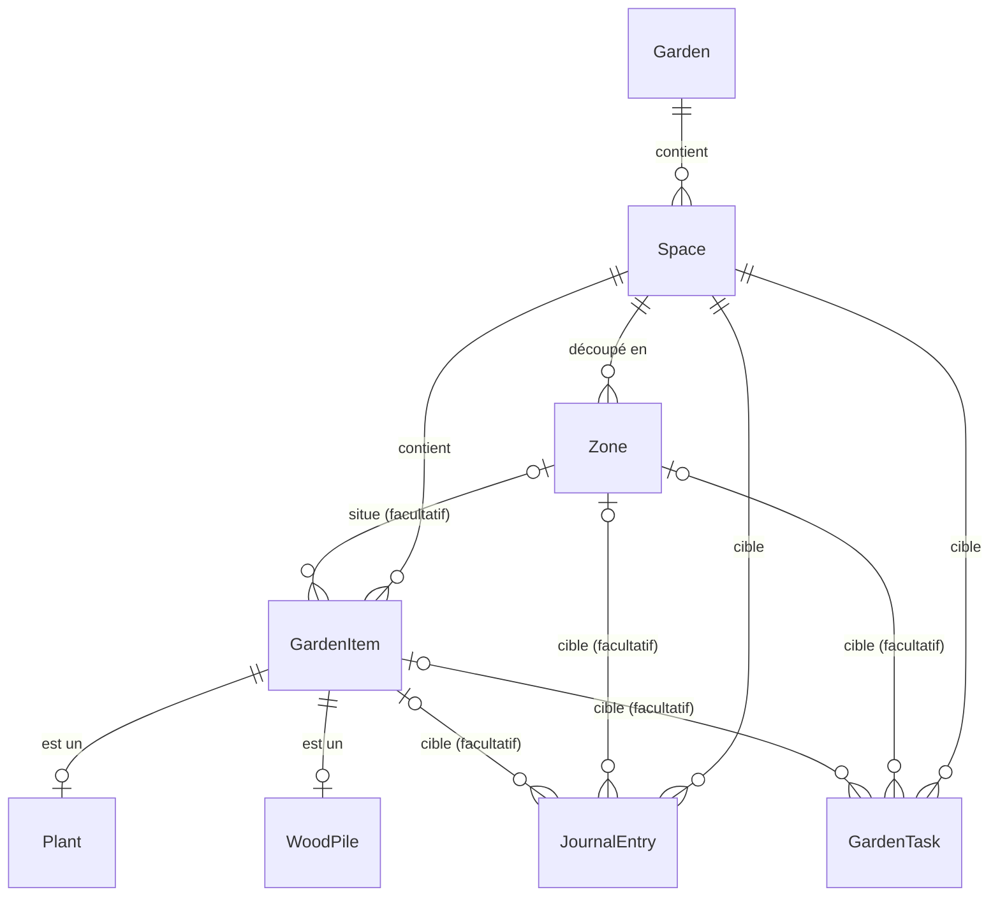

# Modèle du domaine : proposition

Modèle qui traduit la [vision produit](vision-produit.md). L'app l'implémente en entier (la
première version, en API .NET, est au tag `api-dotnet`) : les
quatre étapes de la [migration](#stratégie-de-migration) (jardin et espaces, journal, tâches,
bois de chauffage) sont faites. Les noms d'entités sont ceux du code (en anglais).

## Vue d'ensemble

## Entités

### Garden (jardin)

Nom, date de création. Un seul jardin au MVP, sans sélecteur dans l'app. L'entité existe dès
le départ pour accueillir plus tard plusieurs jardins et le partage au sein d'un foyer (le
propriétaire et les membres se rattacheront au jardin).

### Space (espace)

Appartient à un jardin. Nom, description, `Kind`, archivage.

`Kind` au MVP : `VegetableGarden` (potager), `Orchard` (verger), `SmallFruit` (petits fruits),
`Greenhouse` (serre, découpée si besoin en tablettes ou bacs), `Firewood` (bois de chauffage).
Plus tard : aromatiques, massifs, pelouse, compost, poulailler… Le type décide des éléments qu'on peut y ajouter (pas de culture dans un espace
bois), des types d'intervention et de tâche proposés, et de l'icône.

Les données de la carte isométrique (position, emprise, type visuel) relèvent de l'étude qui
lui est consacrée. Elles se rattacheront à `Space` et, si besoin, à `Zone`, sans changer les
entités décrites ici.

### Zone

Subdivision facultative d'un espace : carré, planche, rang. Nom, description, unique dans son
espace. La zone d'aujourd'hui garde son nom mais descend d'un niveau : elle n'est plus la
racine du jardin.

### GardenItem (élément suivi)

Base commune de tout ce qu'on suit : nom, espace, zone facultative (qui doit appartenir au même
espace), archivage, date de création.

Héritage **TPH** (une table, une colonne discriminante) : le journal et les tâches doivent
pointer vers une seule table, et SQLite s'en accommode sans jointure. Deux types au MVP :

- **Plant** : culture, arbre ou arbuste. Espèce et variété en texte libre, quantité et unité
  (pieds, rangs, m²), date de semis, date de plantation. Une `Plant` est un sujet seul ou un
  groupe de sujets identiques suivis ensemble, au choix de l'utilisateur, quel que soit le type
  d'espace : « 3 pommiers Golden » est une `Plant` de quantité 3 pieds, « 1 ligne de carottes »
  une `Plant` de quantité 1 rang, et le pommier qu'on veut suivre seul une `Plant` de quantité
  1. La quantité est strictement positive ; en pieds, elle est entière. Une culture de potager
  est archivée en fin de saison : l'historique par carré reste consultable. Le comportement
  propre au verger vient du type d'espace, pas d'une entité à part.
- **WoodPile** (tas de bois) : essence (`WoodSpecies`), volume initial en stères, longueur des
  bûches (facultative), date de coupe, durée de séchage en mois (0 pour du bois acheté sec). Il
  n'est accepté que dans un espace bois de chauffage, comme une `Plant` n'y est pas acceptée.
  Calculés à la lecture, jamais stockés, par `WoodPileCalculator` (pur et sans dépendance) :
  - le **stock restant** : volume initial, plus les apports (`WoodSupply`), moins les
    consommations (`WoodConsumption`) notés au journal **sur ce tas**. Un apport ajoute du bois à
    un tas existant, en plus de son volume initial (un complément livré, du bois repris à un
    autre tas) ; un nouveau tas, lui, se crée avec son volume initial. Une entrée de bois notée
    sur l'espace ou une zone, sans tas, reste au journal mais n'entre dans le stock d'aucun
    (la règle « vaut pour les éléments qu'ils contiennent » ne s'applique pas ici : on ne sait
    pas dans quel tas on a puisé). Le résultat est arrondi au centième de stère ;
  - l'**état de séchage** : le bois est prêt à brûler le jour de la coupe plus la durée de
    séchage, ce jour compris ; avant, il est en séchage. L'app donne `dryingStatus` (`Drying` ou
    `Ready`) et `readyOn`, futur ou passé. Un mois se compte au même quantième, ramené à la fin
    du mois s'il n'existe pas (coupé le 31 janvier, séché un mois : prêt le 28 février).

  **Le stock ne passe jamais sous zéro.** Toute écriture qui le ferait est refusée : noter une
  consommation trop grosse, la corriger ou la reporter sur un autre tas, supprimer un apport déjà
  consommé, ou baisser le volume initial sous ce qui a été consommé. Seul le total compte, pas
  l'ordre des dates. Consommer exactement le reste est permis ; un tas épuisé s'archive.
  Un tas se déplace vers un autre espace bois de chauffage avec son journal et ses tâches, comme
  une plante. Un espace qui contient des tas, archivés compris, ne change pas de type.

  Le journal et les tâches ciblent un tas comme n'importe quel élément. « Rentrer le bois » se
  prévoit en tâche « autre » avec un titre : une tâche d'apport ou de consommation de bois ne
  pourrait pas être faite, l'entrée exigeant un volume que l'action « Fait » ne porte pas.

### JournalEntry (intervention)

Une chose faite au jardin. Date (jamais dans le futur), `Kind`, note facultative, et des
champs facultatifs selon le type.

`Kind` au MVP : `Watering` (arrosage), `Sowing` (semis), `Planting` (plantation), `Pruning`
(taille), `Treatment` (traitement), `Fertilizing` (fertilisation), `Harvest` (récolte),
`Observation`, `WoodSupply` (apport de bois), `WoodConsumption` (consommation de bois), `Other`
(autre).

| Champ | Accepté pour | Règle |
|---|---|---|
| Quantité et unité | Récolte, bois | Toujours ensemble. Récolte : kilos, grammes ou pièces, facultative. Bois : stères, obligatoire |
| Hauteur (cm) | Observation | |
| Problème constaté, traitement appliqué | Observation, traitement | |
| Note | Tous | Obligatoire pour « autre » ; une observation porte au moins une note, une hauteur ou un problème |

Le type doit aussi convenir à l'espace : le bois ne se note que dans un espace bois de
chauffage, les soins aux plantes (arrosage à récolte) que dans un espace qui accueille des
plantes ; observation et « autre » se notent partout. Un espace ne change pas de type si son
journal contient des entrées que le nouveau type refuse.

**Cible** : un espace obligatoire, plus une zone ou un élément facultatifs. « Désherber le
carré 2 » vise une zone, « tailler le pommier » un élément, « tondre » tout l'espace. Le
journal d'un espace se lit donc sans jointure. La cohérence est garantie à l'écriture : la zone
et l'élément appartiennent à l'espace, et l'élément est dans la zone si les deux sont donnés.
Une entrée sur un élément situé dans une zone prend cette zone d'office, pour que le journal
d'une zone se lise lui aussi sans jointure.

**Les entrées d'un élément le suivent.** Déplacer une plante déplace ses entrées vers son
nouvel espace et sa nouvelle zone : la cible d'une entrée est toujours cohérente, et supprimer
un espace ou une zone vidés de leurs éléments n'emporte jamais l'historique d'un élément. Pour
garder un historique à sa place (semis de la serre repiqué au potager), on archive l'élément
et on en crée un nouveau. Une cible archivée (élément ou espace) ne reçoit plus de nouvelle
entrée ; ses entrées existantes restent corrigeables.

**Règle d'application : une intervention notée sur une zone ou sur un espace vaut pour les
éléments qu'ils contiennent.** « Arroser le carré 2 » compte comme arrosage de chaque plante du
carré, « arroser le verger » de chaque arbre du verger, zones comprises. L'élément est pris là
où il se trouve au moment de la lecture ; on ne garde pas l'historique de ses déplacements. La
règle sert :

- à l'échéance des tâches, pour tout type d'intervention (`LatestInterventions`) : la dernière
  intervention qui vaut pour un élément est la plus récente de celles notées sur lui, sur sa
  zone et sur tout son espace ; pour une zone, sur elle et sur tout son espace ; pour un
  espace, sur lui seul. Arroser une plante n'arrose pas son carré ;
- à la lecture du journal : celui d'un élément montre ses entrées et celles de sa zone et de
  son espace ; celui d'une zone, ses entrées, celles de ses éléments et celles de tout
  l'espace ; celui d'un espace, tout ce qui s'y est fait.

Le journal se lit du plus récent au plus ancien, pour tout le jardin ou pour une seule cible,
filtré par types d'intervention. Une entrée peut être corrigée (cible comprise) ou supprimée :
rien n'en est recopié ailleurs, échéances et stock de bois sont recalculés à la lecture.
Supprimer un élément, une zone ou un espace (ces deux derniers vides d'éléments) supprime les
entrées notées dessus.

### GardenTask (tâche)

Une chose à faire. Même cible que le journal, un `Kind` d'intervention, un titre facultatif
et une récurrence :

- **tous les N jours** (arroser tous les 3 jours) ;
- **chaque année** à partir d'une date (tailler chaque 1er février) ;
- **une seule fois**, à une date donnée.

La cible suit les règles du journal (cohérence vérifiée, zone prise d'office pour un élément
situé dans une zone, type d'intervention accepté par l'espace, pas de nouvelle tâche sur une
cible archivée), et **les tâches d'un élément le suivent** quand il est déplacé. Une tâche
« autre » porte un titre. Un espace ne change pas de type si ses tâches contiennent un type que
le nouveau refuse.

**L'échéance est calculée, jamais stockée** (`DueDateCalculator`, pur et sans dépendance), à
partir de la dernière entrée du journal de même `Kind` qui vaut pour la cible, selon la règle
d'application du journal :

| Récurrence | Date de départ | Échéance |
|---|---|---|
| Tous les N jours | Première échéance | Dernière fois + N jours, mais jamais avant la date de départ ; à défaut, la date de départ |
| Chaque année | Date anniversaire, à partir de cette année-là | La date anniversaire qui suit celle que la dernière fois a faite ; à défaut, la date de départ |
| Une seule fois | Jour prévu | Le jour prévu, jusqu'à ce qu'une entrée datée du jour de création de la tâche ou après existe : la tâche est alors close |

- **Tous les N jours** : un historique plus ancien que la date de départ ne fait pas naître la
  tâche en retard. C'est ce qui remplace l'ancienne règle « une plantation relance le décompte
  d'arrosage » : une plante arrivée dans un carré arrosé il y a dix jours reçoit une tâche qui
  part d'aujourd'hui.
- **Chaque année : une intervention compte pour la date anniversaire si elle est faite au plus
  30 jours avant**, ou n'importe quand après (en retard). Tailler le 25 janvier fait la taille
  du 1er février : la suivante tombe le 1er février de l'an prochain. Une taille en vert de
  septembre ne fait pas la taille d'hiver qui vient ; elle compte, en retard, pour le dernier
  1er février passé. Une tâche jamais faite est due depuis sa date de départ, même lointaine.
  Une date anniversaire au 29 février tombe le 28 les années non bissextiles.
- **Une seule fois : close par une intervention notée à partir du jour où la tâche a été
  créée**, qu'elle tombe avant ou après le jour prévu. « Traiter les rosiers le 25 octobre »,
  créée le 20 et faite le 23, est close le 23. Une intervention antérieure à la création ne
  compte pas : un arrosage de la semaine dernière ne ferme pas un « arroser » ponctuel créé
  aujourd'hui. Le jour de création compte, lui : un premier traitement noté le jour même où l'on
  crée « renouveler dans dix jours » clôt la tâche (la comparaison se fait au jour, pas à l'heure).

Le voyant vaut pour toute tâche : `Ok` (échéance future ou tâche ponctuelle close), `DueSoon`
(échéance aujourd'hui), `Overdue` (échéance passée, avec le nombre de jours de retard). Faire
une tâche, c'est noter l'intervention au journal : il n'y a pas de statut « faite » à tenir à
jour. L'action « Fait » note l'entrée sur la cible de la tâche, à la date du jour ou à une date
passée, avec le titre de la tâche pour note à défaut d'une autre. Les tâches d'un élément ou
d'un espace archivé ne sont jamais dues.

Les tâches se lisent comme le journal : pour tout le jardin, ou pour une cible (celles d'un
élément comprennent celles de sa zone et de son espace). Les tâches dues, toutes catégories,
se lisent les plus en retard d'abord, pour aujourd'hui ou pour les sept prochains jours ; chaque
espace donne son nombre de tâches dues.

## Commun et propre à chaque type

| Commun à tous les éléments | Propre à un type |
|---|---|
| Espace, zone, nom, archivage | `Plant` : espèce, variété, quantité, semis, plantation |
| Journal d'interventions | `WoodPile` : essence, stères, coupe, séchage, stock calculé |
| Tâches et voyant d'échéance | Types d'intervention et de tâche proposés selon le type d'espace |

On n'ajoute un sous-type de `GardenItem` que si ses champs diffèrent vraiment. Un framboisier,
un pommier et un rang de carottes sont tous des `Plant`.

## Impact sur le modèle actuel

| Avant | Après | Étape |
|---|---|---|
| `Zone` (racine) | `Garden` → `Space` (typé) → `Zone` (facultative) | 1, faite |
| `Plant` avec `ZoneId` | `Plant`, sous-type de `GardenItem`, avec `SpaceId` et `ZoneId` facultatif, plus variété et quantité | 1, faite |
| `WateringLog` | `JournalEntry` de type arrosage | 2, faite |
| `Observation` (note, hauteur, problème, traitement) | `JournalEntry` de type observation ou traitement, mêmes champs | 2, faite |
| `POST /api/zones/{id}/waterings` (un arrosage par plante) | Une seule entrée sur la zone, qui vaut pour ses plantes ; toute intervention se note aussi sur une zone ou un espace via `POST /api/journal` | 2, faite |
| `Plant.WateringIntervalDays` | Une `GardenTask` d'arrosage tous les N jours | 3, faite |
| `WateringCalculator`, `wateringStatus` | `DueDateCalculator` générique, statut sur chaque tâche | 3, faite |
| `GET /api/watering/needed`, raccourcis d'arrosage d'une plante ou d'une zone | `GET /api/tasks/due` (toutes catégories) et l'action « Fait » `POST /api/tasks/{id}/done` | 3, faite |
| Rien (le bois n'existait pas) | `WoodPile`, sous-type de `GardenItem`, avec stock restant et séchage calculés ; `/api/wood-piles` | 4, faite |

Les règles de l'API .NET (tag `api-dotnet`) restent la référence que reprennent les services de `src/data/` : contrôleurs fins et services métier, ProblemDetails,
`TimeProvider`, DTOs séparés, contraintes en Fluent API.

## Stratégie de migration

Aucune donnée réelle n'existe : seule la base de développement, remplie par `DbSeeder`. On
n'écrit donc **aucun script de reprise de données**.

- On ajoute de nouvelles migrations EF Core, sans réécrire l'historique.
- À chaque étape, la base de dev est recréée (supprimer `Jardo.Api/jardo.db`) et `DbSeeder`
  est réécrit pour un jardin d'exemple complet : un potager en carrés, un verger, des petits
  fruits, un tas de bois.
- Les tests suivent chaque étape dans la même PR.

Étapes de code, une PR chacune, l'API restant cohérente à chaque fois :

1. **Jardin et espaces.** `Garden`, `Space` typé, `Zone` rattachée à un espace ; `Plant`
   devient un sous-type de `GardenItem` (TPH), avec variété et quantité.
2. **Journal unifié.** `JournalEntry` remplace `WateringLog` et `Observation`.
3. **Tâches.** `GardenTask`, calculateur d'échéance générique ; l'intervalle d'arrosage de
   `Plant` devient une tâche ; endpoint des tâches dues.
4. **Bois de chauffage.** `WoodPile`, stock et séchage calculés.

Les quatre étapes sont faites. La refonte des écrans vient ensuite, sur le nouveau modèle et les
maquettes revues.

Le jour où l'app aura des utilisateurs, chaque changement de schéma devra conserver les
données : migrations avec reprise, testées sur une copie de la base.
