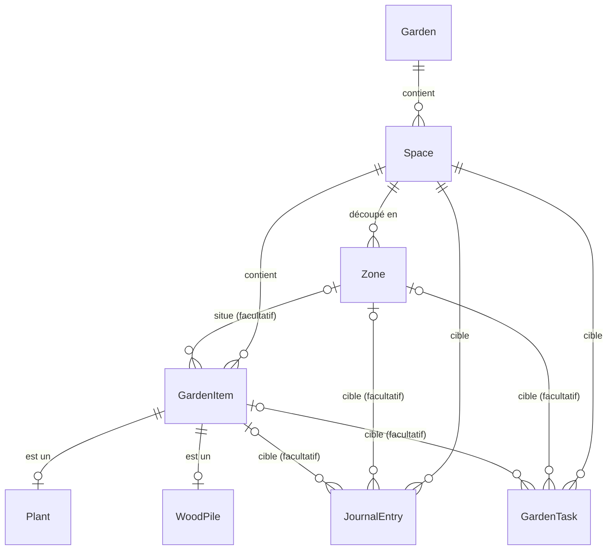

# Modèle du domaine : proposition

Proposition conceptuelle qui traduit la [vision produit](vision-produit.md). L'API
l'implémente par étapes (voir [Stratégie de migration](#stratégie-de-migration)) : l'étape 1,
jardin, espaces, zones et plantes, est faite. Les noms d'entités sont ceux du code (en
anglais) ; les champs listés sont indicatifs et sont arrêtés dans chaque PR.

## Vue d'ensemble

## Entités

### Garden (jardin)

Nom, date de création. Un seul jardin au MVP, sans sélecteur dans l'app. L'entité existe dès
le départ pour accueillir plus tard plusieurs jardins et le partage au sein d'un foyer (le
propriétaire et les membres se rattacheront au jardin).

### Space (espace)

Appartient à un jardin. Nom, description, `Kind`, archivage.

`Kind` au MVP : `VegetableGarden` (potager), `Orchard` (verger), `SmallFruit` (petits fruits),
`Firewood` (bois de chauffage). Plus tard : serre, aromatiques, massifs, pelouse, compost,
poulailler… Le type décide des éléments qu'on peut y ajouter (pas de culture dans un espace
bois), des types d'intervention et de tâche proposés, et de l'icône.

Les données de la carte isométrique (position, emprise, type visuel) relèvent de l'étude qui
lui est consacrée. Elles se rattacheront à `Space` et, si besoin, à `Zone`, sans changer les
entités décrites ici.

### Zone

Subdivision facultative d'un espace : carré, planche, rang. Nom, description, unique dans son
espace. La zone d'aujourd'hui garde son nom mais descend d'un niveau : elle n'est plus la
racine du jardin.

### GardenItem (élément suivi)

Base commune de tout ce qu'on suit : nom, espace, zone facultative (qui doit appartenir au même
espace), archivage, date de création.

Héritage **TPH** (une table, une colonne discriminante) : le journal et les tâches doivent
pointer vers une seule table, et SQLite s'en accommode sans jointure. Deux types au MVP :

- **Plant** : culture, arbre ou arbuste. Espèce et variété en texte libre, quantité et unité
  (pieds, rangs, m² ; 1 pour un arbre), date de semis, date de plantation. Une culture de
  potager est archivée en fin de saison : l'historique par carré reste consultable. Un arbre
  fruitier est une `Plant` de quantité 1 dans un verger ; le comportement propre au verger
  vient du type d'espace, pas d'une entité à part.
- **WoodPile** (tas de bois) : essence, volume initial en stères, longueur des bûches, date de
  coupe, durée de séchage en mois. Calculés à la lecture, jamais stockés : le **stock
  restant** (volume initial − consommations notées au journal) et l'**état de séchage**
  (en séchage, prêt à brûler à partir de telle date).

### JournalEntry (intervention)

Une chose faite au jardin. Date, `Kind`, note, et des champs facultatifs selon le type :
quantité et unité (récolte, bois), hauteur, problème constaté, traitement appliqué.

`Kind` au MVP : arrosage, semis, plantation, taille, traitement, fertilisation, récolte,
observation, apport de bois, consommation de bois, autre.

**Cible** : un espace obligatoire, plus une zone ou un élément facultatifs. « Désherber le
carré 2 » vise une zone, « tailler le pommier » un élément, « tondre » tout l'espace. Le
journal d'un espace se lit donc sans jointure.

Une entrée peut être corrigée ou supprimée : rien n'en est recopié ailleurs, échéances et
stock de bois sont recalculés à la lecture.

### GardenTask (tâche)

Une chose à faire. Même cible que le journal, un `Kind` d'intervention, un titre facultatif
et une récurrence :

- **tous les N jours** (arroser tous les 3 jours) ;
- **chaque année** à partir d'une date (tailler chaque 1er février) ;
- **une seule fois**, à une date donnée.

**L'échéance est calculée, jamais stockée**, sur le principe du voyant actuel : dernière
entrée du journal de même `Kind` sur la même cible, plus la récurrence ; à défaut, la date de
départ de la tâche. Faire une tâche, c'est noter l'intervention au journal : il n'y a pas de
statut « faite » à tenir à jour. Une tâche ponctuelle est close dès qu'une entrée de même type
et de même cible existe à sa date ou après.

Le voyant `Ok` / `DueSoon` / `Overdue` s'applique à toute tâche. `WateringCalculator`
devient un calculateur d'échéance générique, toujours pur et sans dépendance.

## Commun et propre à chaque type

| Commun à tous les éléments | Propre à un type |
|---|---|
| Espace, zone, nom, archivage | `Plant` : espèce, variété, quantité, semis, plantation |
| Journal d'interventions | `WoodPile` : essence, stères, coupe, séchage, stock calculé |
| Tâches et voyant d'échéance | Types d'intervention et de tâche proposés selon le type d'espace |

On n'ajoute un sous-type de `GardenItem` que si ses champs diffèrent vraiment. Un framboisier,
un pommier et un rang de carottes sont tous des `Plant`.

## Impact sur le modèle actuel

| Aujourd'hui | Demain |
|---|---|
| `Zone` (racine) | `Garden` → `Space` (typé) → `Zone` (facultative) |
| `Plant` avec `ZoneId` | `Plant`, sous-type de `GardenItem`, avec `SpaceId` et `ZoneId` facultatif, plus variété et quantité |
| `Plant.WateringIntervalDays` | Une `GardenTask` d'arrosage tous les N jours |
| `WateringLog` | `JournalEntry` de type arrosage |
| `Observation` (note, hauteur, problème, traitement) | `JournalEntry` de type observation ou traitement, mêmes champs |
| `WateringCalculator`, `wateringStatus` | Calculateur d'échéance générique, statut sur chaque tâche |
| `GET /api/watering/needed` | Tâches dues (toutes catégories) |
| `POST /api/zones/{id}/waterings` | Intervention sur une zone ou un espace |

Les règles en place restent valables : contrôleurs fins et services métier, ProblemDetails,
`TimeProvider`, DTOs séparés, contraintes en Fluent API.

## Stratégie de migration

Aucune donnée réelle n'existe : seule la base de développement, remplie par `DbSeeder`. On
n'écrit donc **aucun script de reprise de données**.

- On ajoute de nouvelles migrations EF Core, sans réécrire l'historique.
- À chaque étape, la base de dev est recréée (supprimer `Jardo.Api/jardo.db`) et `DbSeeder`
  est réécrit pour un jardin d'exemple complet : un potager en carrés, un verger, des petits
  fruits, un tas de bois.
- Les tests suivent chaque étape dans la même PR.

Étapes de code, une PR chacune, l'API restant cohérente à chaque fois :

1. **Jardin et espaces.** `Garden`, `Space` typé, `Zone` rattachée à un espace ; `Plant`
   devient un sous-type de `GardenItem` (TPH), avec variété et quantité.
2. **Journal unifié.** `JournalEntry` remplace `WateringLog` et `Observation`.
3. **Tâches.** `GardenTask`, calculateur d'échéance générique ; l'intervalle d'arrosage de
   `Plant` devient une tâche ; endpoint des tâches dues.
4. **Bois de chauffage.** `WoodPile`, stock et séchage calculés.

La refonte des écrans vient ensuite, sur le nouveau modèle et les maquettes revues.

Le jour où l'app aura des utilisateurs, chaque changement de schéma devra conserver les
données : migrations avec reprise, testées sur une copie de la base.
